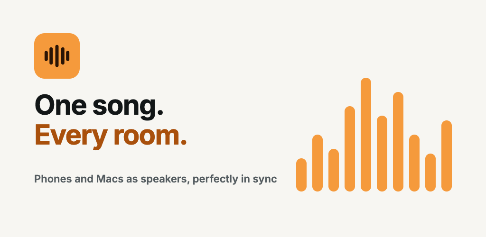
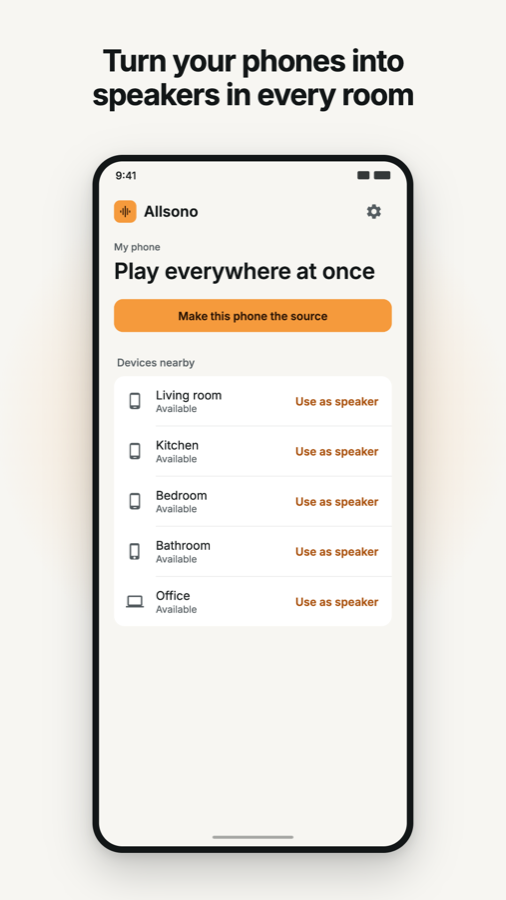
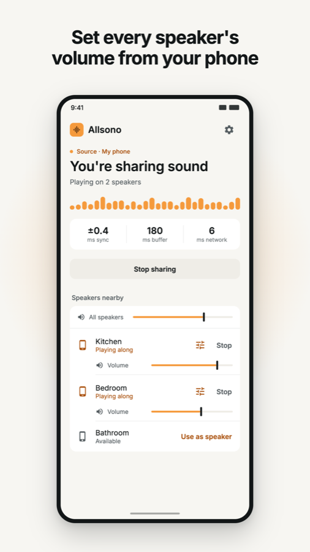
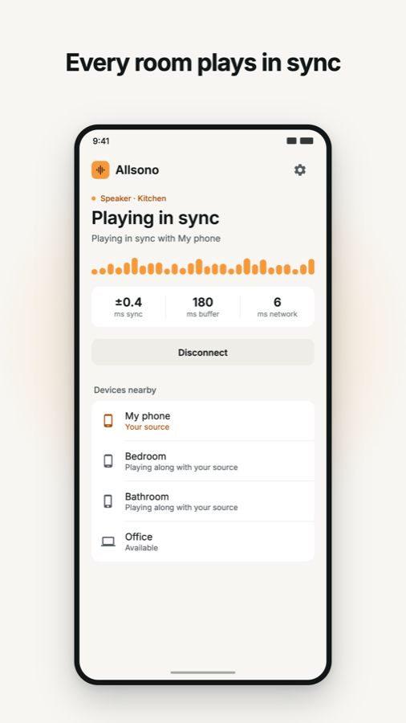

### Hi, I'm David

Software engineer from the Netherlands. Most of my time now goes into **Allsono**, an app I build on my own, for Android, iOS, Mac, Windows and Linux.

<a href="https://allsono.com">
  <picture>
    <source media="(prefers-color-scheme: dark)" srcset="assets/allsono-banner-dark.png">
    
  </picture>
</a>

## Allsono

Allsono turns the phones and computers you already own into speakers that play in sync, in every room. One device is the source and the others play along, over your own Wi-Fi. No new speakers, the sound never leaves your home network, and an account is optional.

  
  &nbsp;
  
  &nbsp;
  
  &nbsp;
  

<table>
  <tr>
    <td><picture><source media="(prefers-color-scheme: dark)" srcset="assets/allsono-1-dark.png"></picture></td>
    <td><picture><source media="(prefers-color-scheme: dark)" srcset="assets/allsono-2-dark.png"></picture></td>
    <td><picture><source media="(prefers-color-scheme: dark)" srcset="assets/allsono-3-dark.png"></picture></td>
  </tr>
</table>

**What's inside**

- **Android app** in Kotlin and Jetpack Compose. It captures the sound of other apps and sends it to the speakers.
- **Mac and iOS apps** in Swift and SwiftUI, sharing one Swift core. On the Mac, Core Audio captures the system sound.
- **Windows app** in C# and WPF on .NET 10, from the Microsoft Store. It captures the sound of other apps with WASAPI process loopback, no driver needed.
- **Linux app** in Java and JavaFX, as a .deb with signed self-updates. It captures the system sound through its own PulseAudio/PipeWire sink.
- **My own sync protocol** over the local network. A shared clock keeps every device within a few milliseconds, with uncompressed 16-bit 48 kHz stereo.
- **allsono.com** with Spring Boot (Java) and Vue: accounts, settings sync across devices, and updates for Mac and Linux.
- English, Dutch, German and French. CI on my own runners, deploys on every push.

  
  
  
  
  
  
  
  
  
  

## Find me

[allsono.com](https://allsono.com) · [rerimassie.nl](https://www.rerimassie.nl)
